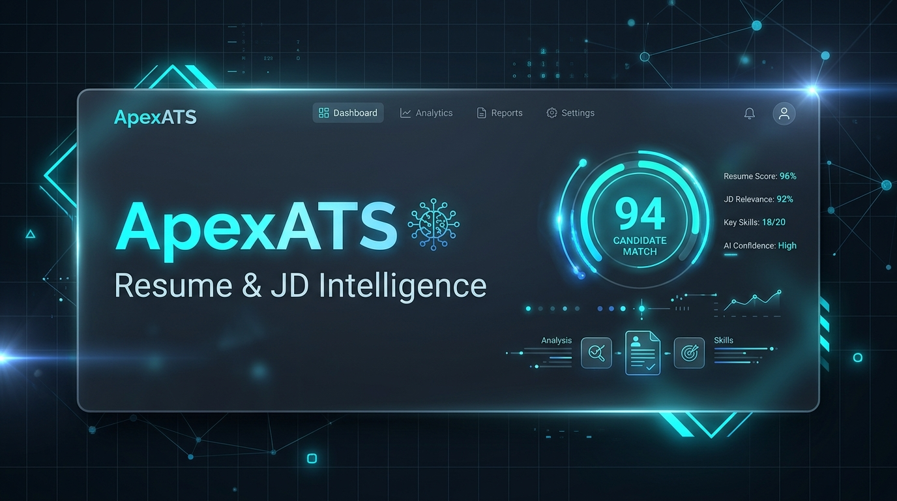
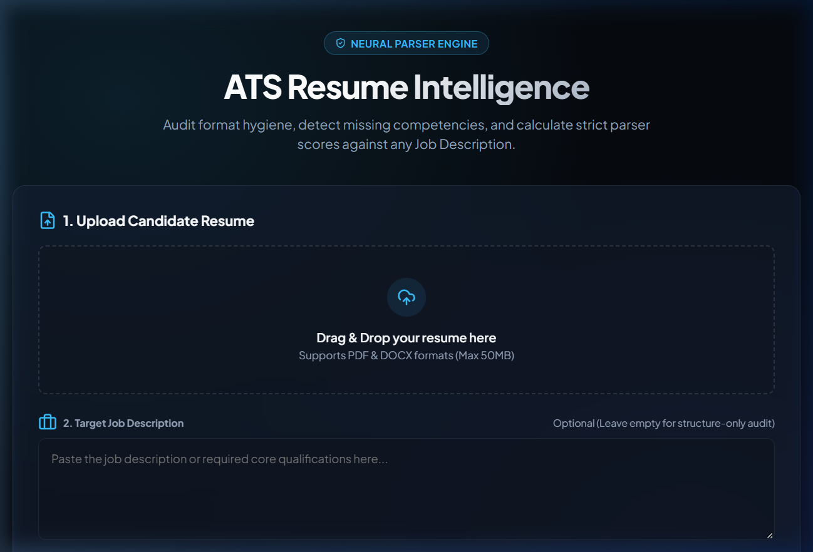
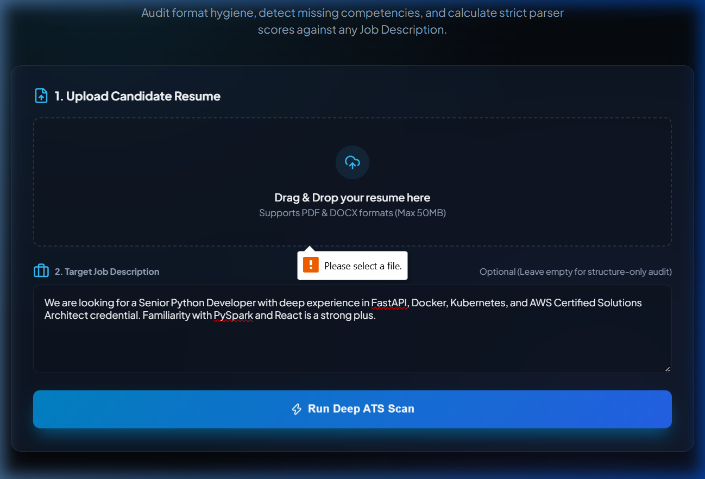
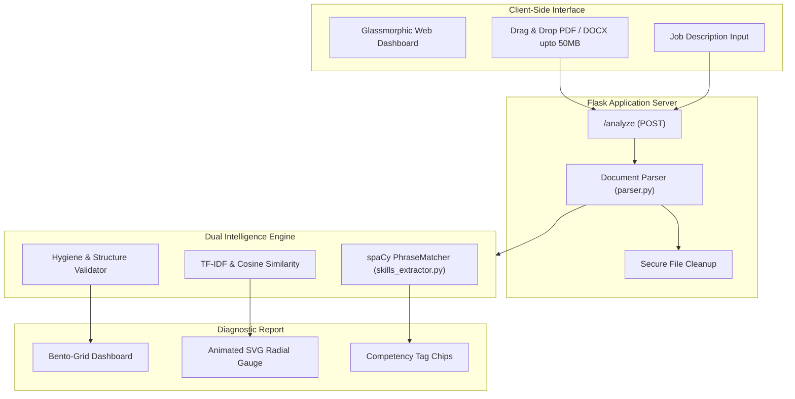

<div align="center">

# ⚡ ApexATS — Next-Gen Resume & JD Intelligence

[](https://www.python.org/)
[](https://flask.palletsprojects.com/)
[](https://spacy.io/)
[](https://scikit-learn.org/)
[](LICENSE)

<br/>

<p align="center">
  
</p>

### *Audit format hygiene, detect missing competencies, and benchmark candidate resumes against any Job Description using hybrid NLP.*

<p align="center">
  <a href="#-key-features">Key Features</a> •
  <a href="#-ui-showcase--snippets">UI Showcase</a> •
  <a href="#-architecture">Architecture</a> •
  <a href="#-getting-started">Getting Started</a> •
  <a href="#-analytical-engine">Analytical Engine</a> •
  <a href="#-api-reference">API</a>
</p>

</div>

---

## 🌟 Key Features

- **🚀 Dual-Mode ATS Intelligence**:
  - **Targeted JD Match**: High-precision semantic cosine similarity + phrase extraction against specific job qualifications.
  - **Structural Hygiene Audit**: Standalone document evaluation checking formatting, section boundaries, contact vectors, action verbs, and impact metrics.
- **🧠 spaCy PhraseMatcher Engine**: Multi-word canonicalized token extraction (`attr="LOWER"`) across hundreds of modern frameworks, data science libraries, cloud platforms, and certifications (e.g., *AWS Certified Solutions Architect*, *Kubernetes*, *FastAPI*).
- **📊 TF-IDF N-Gram Vectorization**: Deep bi-gram vocabulary extraction scoring keyword frequency, relevance weighting, and semantic overlap between candidate experience and role requirements.
- **📁 Multi-Format Heavy Ingestion**: High-throughput parser supporting `.pdf` and `.docx` document formats up to **50 MB** with automatic temporary file cleanup.
- **✨ Production-Grade Glassmorphic Dashboard**:
  - Dark-slate layered glassmorphism (`backdrop-filter: blur(16px)`).
  - Drag-and-drop file upload with visual feedback & real-time MB size display.
  - Animated SVG circular radial score gauge.
  - Multi-stage scanning milestone visualizer.
  - Structured Bento-Grid analytics displaying matched & missing skills.

---

## 📸 UI Showcase & Snippets

<table align="center" width="100%">
  <tr>
    <td width="50%" align="center">
      <b>1. Modern Landing & Ingestion Surface</b><br/><br/>
      
    </td>
    <td width="50%" align="center">
      <b>2. Target JD Benchmarking Mode</b><br/><br/>
      
    </td>
  </tr>
</table>

---

## 🏗️ Architecture



---

## 🔬 Analytical Engine Breakdown

### 1. spaCy PhraseMatcher (`skills_extractor.py`)
Standard pre-trained Named Entity Recognition (NER) models are limited to generic entities (`PERSON`, `ORG`, `GPE`). ApexATS utilizes custom case-insensitive `PhraseMatcher` pipelines disabling unnecessary syntactic parsers for maximum tokenization throughput:
- **Canonical Technical Extraction**: Flags languages, frameworks, cloud stacks, and databases.
- **Hard Certification Discovery**: Captures credentials like *AWS Solutions Architect*, *CKA*, *PMP*, and *CISSP*.

### 2. Semantic Relevance (`analyzer.py`)
Computes unigram & bigram vocabulary representations using **Term Frequency - Inverse Document Frequency (TF-IDF)** to calculate the normalized Cosine Similarity metric:

$$\text{Similarity}(R, JD) = \frac{\mathbf{v}_R \cdot \mathbf{v}_{JD}}{\|\mathbf{v}_R\| \|\mathbf{v}_{JD}\|}$$

Weighted aggregate score formulation:
$$\text{Overall Score} = (0.60 \times \text{Skill Match \%}) + (0.40 \times \text{Hygiene Score})$$

### 3. Resume Hygiene & Impact Audit
- **Core Section Integrity**: Validates `Experience`, `Education`, and `Skills`.
- **Contact Vector Verification**: Regex validation for RFC-compliant emails, international phone patterns, and LinkedIn/GitHub links.
- **Action Verbs & Impact Metrics**: Scans for quantifiable KPIs (`%`, `$`, volume numbers) and strong leadership verbs (*Spearheaded*, *Orchestrated*, *Automated*).
- **Optimal Volume Bounds**: Flags resumes under 250 words or exceeding 1,200 words.

---

## ⚡ Getting Started

### Prerequisites
- Python 3.11 or higher
- Git

### Installation

1. **Clone the repository**:
   ```bash
   git clone https://github.com/DarkSri-1/ats-checker.git
   cd ats-checker
   ```

2. **Create and activate a virtual environment**:
   ```bash
   # Windows (PowerShell)
   python -m venv venv
   .\venv\Scripts\Activate.ps1

   # Linux / macOS
   python3 -m venv venv
   source venv/bin/activate
   ```

3. **Install dependencies**:
   ```bash
   pip install -r requirements.txt
   python -m spacy download en_core_web_sm
   ```

4. **Launch the server**:
   ```bash
   python app.py
   ```

5. **Open in browser**:
   Navigate to [http://127.0.0.1:5000](http://127.0.0.1:5000)

---

## 🔌 API Reference

### `POST /analyze`
Analyzes an uploaded resume against optional job requirements.

**Request:**
- Content-Type: `multipart/form-data`
- Body:
  - `resume` (File, required): `.pdf` or `.docx` file (up to 50MB)
  - `jd_text` (String, optional): Plaintext job description

**Response:**
```json
{
  "mode": "with_jd",
  "overall_fit_score": 84.5,
  "match_percentage": 78.2,
  "skill_score": 85.0,
  "hygiene_score": 90,
  "word_count": 482,
  "action_verb_count": 8,
  "matched_skills": ["Python", "Fastapi", "Docker", "Aws"],
  "missing_skills": ["Kubernetes"],
  "matched_certifications": ["AWS Certified Solutions Architect"],
  "missing_certifications": [],
  "feedback": [
    "Formatting and structure adhere to ATS standards."
  ]
}
```

---

## 📂 Repository Structure

```
├── assets/
│   ├── hero_banner.jpg      # High-res glassmorphic hero visual
│   ├── landing_preview.png  # UI landing page snippet
│   └── jd_scan_view.png     # UI scan view snippet
├── templates/
│   └── index.html           # Production glassmorphic dashboard
├── analyzer.py              # TF-IDF, hygiene scoring & aggregate metrics
├── app.py                   # Flask backend routing & upload management
├── parser.py                # Multi-format document parser (.pdf & .docx)
├── skills_extractor.py      # spaCy PhraseMatcher NLP entity extractor
├── requirements.txt         # Package dependencies
└── README.md                # Project documentation
```

---

## 📄 License
This project is licensed under the [MIT License](LICENSE).

<div align="center">
  <sub>Built with ❤️ using Python, Flask, spaCy & scikit-learn.</sub>
</div>
